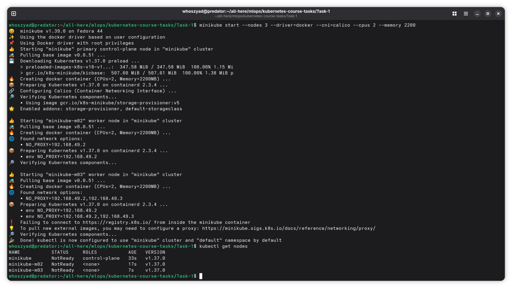
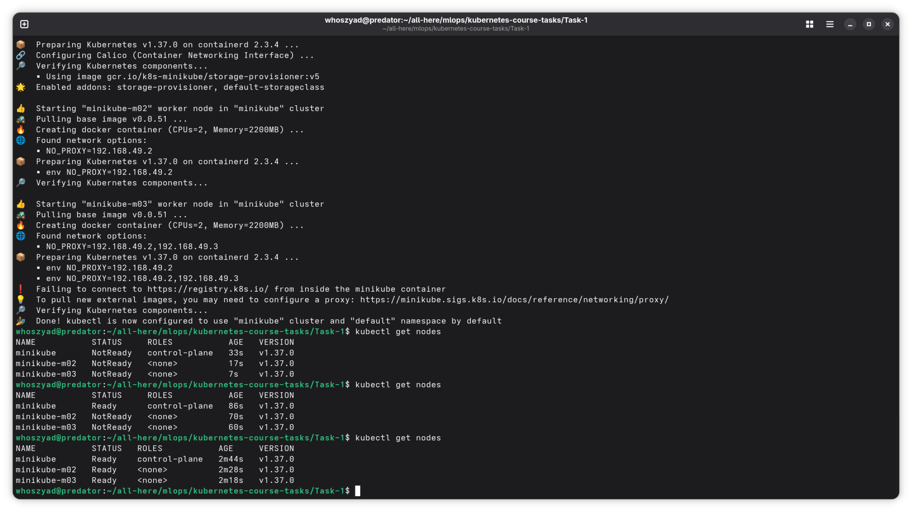
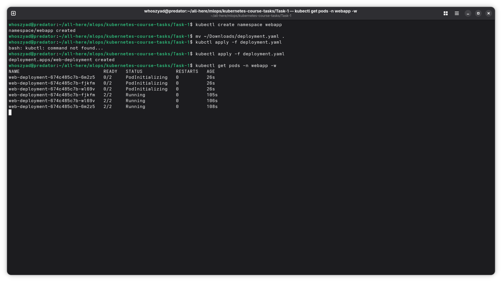
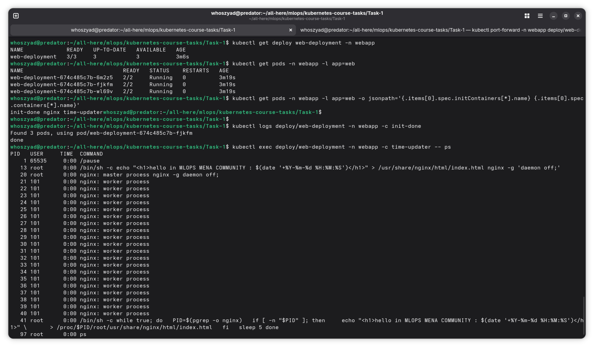
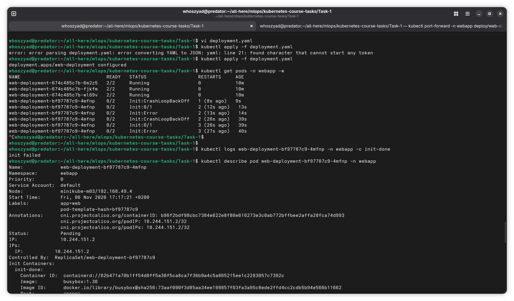

# Task 1: Multi-container Pods (Init Container & Sidecar)

A 3-replica nginx Deployment on a 3-node minikube cluster. Each Pod has an init container, an nginx container and a sidecar that updates the page time every 5 seconds, with no volumes. At the end, the init container is made to fail to see how Kubernetes reacts.

Files in this folder: `deployment.yaml`, `screenshots/`

---

## Step 1: Create the cluster

```bash
minikube start --nodes 3 --driver=docker --cni=calico --cpus 2 --memory 2200
kubectl get nodes
```

minikube creates 3 nodes (1 control-plane + 2 workers) as Docker containers and installs the Calico network plugin. Right after startup the nodes are `NotReady` while Calico starts.



After about 2 minutes, all 3 nodes are `Ready`.



---

## Step 2: Create the namespace and deploy

```bash
kubectl create namespace webapp
kubectl apply -f deployment.yaml
kubectl get pods -n webapp -w
```

The 3 Pods go from `PodInitializing` (init container running) to `2/2 Running` (nginx + time-updater). It is 2/2 because the finished init container is not counted.



---

## Step 3: Open the page

```bash
kubectl port-forward -n webapp deploy/web-deployment 8080:80
```

Then open `http://localhost:8080`. The time changes after 5 seconds, which proves the sidecar is rewriting the page.

(The time is in UTC because it comes from inside the container, so it is 2 hours behind Cairo time.)


---

## Step 4: Verify

```bash
kubectl get deploy web-deployment -n webapp
kubectl get pods -n webapp -l app=web
kubectl get pods -n webapp -l app=web -o jsonpath='{.items[0].spec.initContainers[*].name} {.items[0].spec.containers[*].name}'
kubectl logs deploy/web-deployment -n webapp -c init-done
kubectl exec deploy/web-deployment -n webapp -c time-updater -- ps
```

| Check | Result |
|---|---|
| Deployment | `READY 3/3` |
| Pods | 3 Pods, each `2/2 Running` |
| Container names | `init-done nginx time-updater` |
| Init container log | `done` |
| `ps` from the sidecar | shows `nginx: master process`, so the sidecar can see nginx (`shareProcessNamespace: true`) |



---

## Step 5: Make the init container fail

In `deployment.yaml`, change only the init container command to:

```yaml
command: ["sh", "-c", "echo 'init failed'; exit 1"]
```

Apply it again (without deleting the Deployment) and watch:

```bash
kubectl apply -f deployment.yaml
kubectl get pods -n webapp -w
kubectl logs <new-pod> -n webapp -c init-done
kubectl describe pod <new-pod> -n webapp
```

What happened:
- The new Pod goes `Init:Error` -> `Init:CrashLoopBackOff` and stays at `0/2`.
- `kubectl logs` prints `init failed`.
- The 3 old Pods stay `2/2 Running`.



### Answers

**Which status does the new Pod show?**
`Init:Error`, then `Init:CrashLoopBackOff`, with READY `0/2`. Kubernetes keeps restarting the failing init container with longer and longer delays.

**Do nginx and time-updater start?**
No. Main containers only start after all init containers succeed, so they stay in `PodInitializing`.

**Is the page still reachable, and why?**
Yes. The Deployment does a rolling update: it only removes an old Pod when the new one is Ready. The new Pod never becomes Ready, so the 3 old working Pods keep serving the page.

---

## Step 6: Fix it

Change the command back to `echo done`, then:

```bash
kubectl apply -f deployment.yaml
kubectl get deploy web-deployment -n webapp
```

Expected: `READY 3/3` and `UP-TO-DATE 3`.


---

## Notes

- Two commands failed on the first try and worked on the second: `kubectl apply` right after installing kubectl (`command not found`, new terminal needed) and `kubectl apply` after editing in vim (a YAML typo on line 21). Both were fixed and re-applied.
- `kubectl describe` shows `Exit Code: 1` for `init-done`, confirming the failure.
